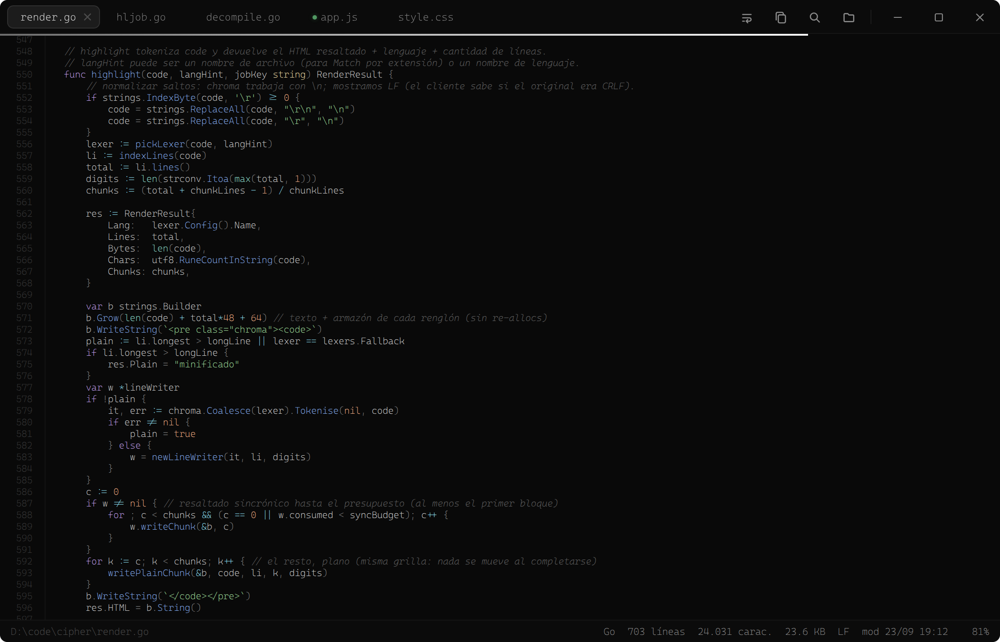
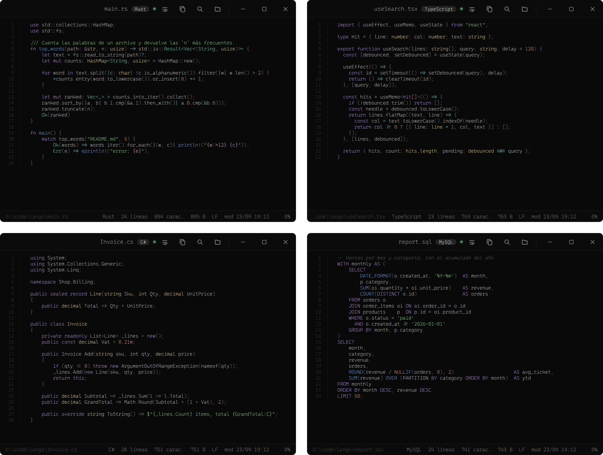
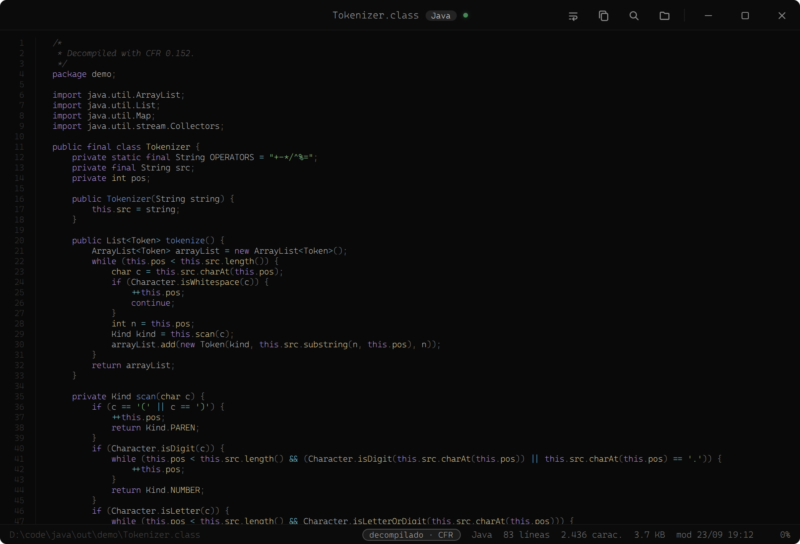
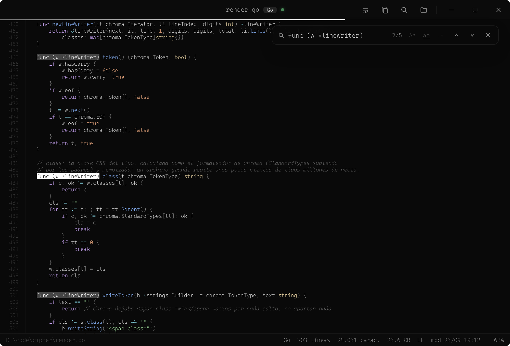
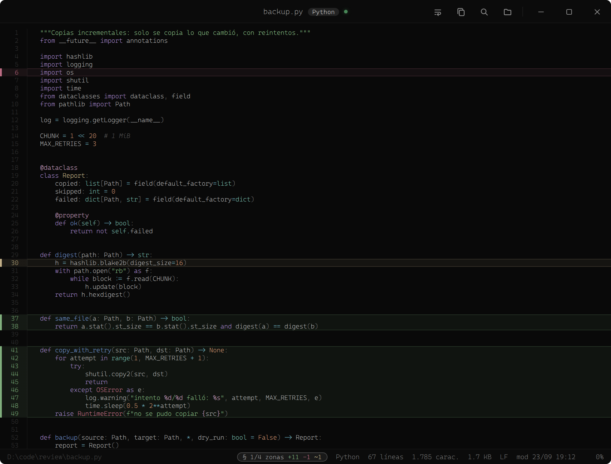

<p align="right"><sub><b>English</b> · <a href="README.md">Español</a></sub></p>

<div align="center">

# Cipher

**A dark, frameless, ultra-minimal code viewer for Windows.**

It highlights **more than 250 languages** and *decompiles* Java `.class` files on the fly. All the highlighting lives in
Go: no Electron, no CDN, no runtime dependencies. A single portable `.exe`.


[](https://github.com/agustinyarrus/cipher/releases/latest)
[](https://github.com/agustinyarrus/cipher/releases)



Sibling of [Folio](https://github.com/agustinyarrus/folio) · [Lumen](https://github.com/agustinyarrus/lumen) · [Lux](https://github.com/agustinyarrus/lux).

</div>

---

## ✨ What it is

**Cipher** opens any code file and shows it **nicely formatted**: syntax highlighting,
line numbers, tabs, search, zoom and live reload. It's **read-only**, made for
*reading* beautiful code, not editing it: the viewer you want in the **"Open with"** menu to look at a
file without waiting for an IDE to start.

It's a single [WebView2](https://developer.microsoft.com/microsoft-edge/webview2/) window **without the system
frame**: the app itself draws the title bar, the tabs and the buttons. The chrome is
**Onyx** (pure black and monochrome) and the code comes in a **pastel rainbow** (the Catppuccin family), in
Cascadia Code ExtraLight always resting on the physical pixel grid. The highlighting is done by **Go**
with [chroma](https://github.com/alecthomas/chroma) (a port of Pygments) compiled into the `.exe`:
**it works 100% offline**.

## 🔤 Languages

Everything chroma can highlight: **297 lexers** and **496 extensions**, from `.go` to `.zig`, by way of
`Dockerfile`, `.ps1`, `.sql`, `.tf`, `.proto` or `.vue`. The language comes from the **file name**
(the extension, or special names like `Dockerfile` and `Makefile`) and, if that isn't enough, from the
**content**.



- **Windows encodings**: a `.reg` exported by regedit, a `.ps1` from the ISE or a `.txt` from
  Notepad often come in **UTF-16**; Cipher decodes them on its own, with or without a BOM, and the status
  bar tells you which one it was (`UTF-16 LE`, `UTF-8 BOM`…).
- **Line endings** in plain sight: `LF`, `CRLF`, `CR` or **`Mixto`** (mixed), the classic file with
  mixed endings after a merge.
- **Binaries**: a notice in the middle instead of a pile of garbage (git's heuristic: a NUL
  byte in the first 8 KB).

## ☕ Decompiled `.class`

Open a `.class` and you'll see **Java source**, not bytecode: Cipher runs it through
[CFR](https://github.com/leibnitz27/cfr), which travels **embedded** in the `.exe`, and highlights the result
like any other file. If the inner classes (`Tokenizer$Token.class`…) sit next to it, they come out
in the same file.



- It needs **Java** installed (the `java` on the `PATH` or the one in `JAVA_HOME`). Nothing else does.
- If CFR can't do it, it falls back to the JDK's `javap -p -c` (a disassembly, less pretty but always there).
- Each decompilation is capped at 30 s and the last 32 are remembered: going back to a `.class`
  you already opened is instant, and if the file changes it's decompiled again.
- The status bar flags it with the `decompilado · CFR` pill.

## 🔍 Search across tokens

`Ctrl F` (or `/`) searches the **text of each line**, not node by node: `func (w *lineWriter)` is
found even when it's six different colors. Matches are painted with the CSS Custom Highlight
API, without touching the code's DOM.



- **Aa** matches case, **ab** matches whole words (it understands accents and eñes: `año` doesn't
  show up inside `añoso`) and **.\*** turns on regular expressions. Toggle them with `Alt C`,
  `Alt W` and `Alt R`.
- It starts at the match **closest to what you're reading**; `Enter` / `Shift Enter` (or
  `n` / `p`) step through them. A half-typed regex turns red instead of breaking anything.
- **Go to line** with `Ctrl G`: it accepts `120`, `120:8` (what compilers spit out) and negatives
  (`-1` is the last line), and flashes the line when it gets there.

## 🟩 Marked zones (`--hl`)

For **reviewing changes**: open a file pointing at lines, with diff semantics. Ideal for letting
a script, a git hook or a coding assistant show you what it touched.

```powershell
& "$env:ProgramFiles\Cipher\cipher.exe" backup.py --hl "-6,30,+37-38,+41-49"
```

| Prefix | Color | Meaning |
|---|---|---|
| `+` | green | added |
| `-` | red | deleted |
| *(none)* | cream | modified |



Cipher jumps to the first zone; `n` / `p` (or a click on the `§` pill) step through the rest. The marks
survive live reload, also reach the window that was already open, and opening the
same file without `--hl` clears them. They apply to the **first** file on the command line; the
ranges are written `12-15,40,60-72` and anything that doesn't parse is silently ignored.

## 🎛️ Features

- **Tabs**: each file opens in its own, without duplicates (the same path goes back to its tab), and
  switching is instant and keeps the scroll. With a single file the bar stays as clean as
  ever; the strip only shows up with two. If a file changes on disk while its tab is in the
  background, a **green dot** gives it away; if it's deleted, the name shows up struck through.
- **Live reload**: if the file changes, the view updates on its own **without moving off the line
  you were reading**. It waits for the editor to finish saving, checks date *and* size, doesn't
  repaint if the content is the same and, if the file disappears, it tells you (and comes back on its own if
  it reappears).
- **Big files instantly**: the first screens arrive highlighted and the rest finishes
  highlighting in the background, swapped in place without the view moving (the
  `resaltando N%` pill). The browser only draws the blocks of lines that are in view: a
  300-thousand-line file scrolls without a hitch. A minified file (lines longer than 16 KB) stays
  plain, and anything over 12 MB is cut at a whole line, with a notice.
- A **status bar** with everything: path, language, lines, characters, size, encoding, line
  ending, modification date (`hoy 13:24`, `22/07 13:24`), reading percentage, selected
  characters (`sel 42`) and the zoom when it isn't at 100 %.
- **Line numbers** in a fixed gutter that doesn't scroll away horizontally, and a reading
  progress line under the title bar.
- **Zoom** (`Ctrl ±` / `Ctrl` + wheel, from 60 % to 220 %), **line wrap** (`W`), **copy all**
  (`Ctrl C` with no selection) and **fullscreen** (`F`).
- **Open it every which way**: the native dialog with multi-select (`Ctrl O`), "Open with" /
  "Edit with Cipher" from Explorer, the command line, or drag and drop one or several
  files (what you drop arrives without a path: it looks the same, but without live reload).
- **Single instance**: the first window stays alive and each later `cipher.exe` hands it the
  file and exits, without paying for WebView2's startup again. Reopening is instant.
- **Truly frameless**: Windows 11's rounded corners and dark border, Aero Snap intact, and
  the window is born dark from the very first pixel (no white flash) at the size and place where you
  left it.
- **Truly local only**: the internal server only answers to its own address
  (`127.0.0.1:port`), so a web page can't use DNS rebinding to read files from your disk
  through it.

## 🎨 Palette and typography

The chrome is **Onyx**: pure black, monochrome, with white as its only accent (green and red
are kept for what's functional: live reload, close, errors). The code comes in a **pastel rainbow**
spread out so that no language ends up dominated by a single color:


Everything is set in **Cascadia Code ExtraLight** (200), the thinnest cut there is, with no synthetic bold or
italics. The code body lands on **16 physical px** at 150 % scale (Notepad++'s optical
size at 10 pt) with 20 px lines, and at any zoom or on any monitor the app rounds
body and line height to the **whole physical pixel**: if a line measured 18.6 px, each line would rest
on a different subpixel and the thin stroke would go soft. Only below 6 pt does it step up to Light (300),
because there the stroke is already thinner than a pixel.

## ⚡ Performance

What changed from 1.0 to 1.1 with the new engine: our own streaming formatter (same classes and
same escaping as chroma's, without piling millions of tokens up in memory) and progressive highlighting
in blocks of 256 lines.

| File | 1.0 | 1.1 |
|---|---|---|
| 5 MB `.go` | 9 s | **0.6 s** (the rest is highlighted in the background) |
| 12 MB `.log` | 69 s | **0.1 s** |
| minified `.js`, 2 MB on a single line | 12 s | **instant** (stays plain) |

The `.log` was slow because of language detection, which analyzed the whole file: now it only looks at
the first 16 KB (from 66 s to 3 ms). The limits are guarded by `TestLargeFilesAreFast`.

## ⌨️ Shortcuts

| Key | Action |
|---|---|
| `Ctrl O` | Open (multi-select) |
| `Ctrl F` / `/` | Search |
| `Enter` / `Shift Enter` | Next / previous match |
| `Alt C` / `Alt W` / `Alt R` | **Aa** / **ab** / **.\*** in the search |
| `Ctrl G` | Go to line (`120`, `120:8`, `-1`) |
| `n` / `p` | Next / previous: match or marked zone |
| `Ctrl Tab` / `Ctrl Shift Tab` | Next / previous tab (also `Ctrl PgDn` / `Ctrl PgUp`) |
| `Ctrl 1…9` | Go to tab n |
| `Ctrl W` / middle click | Close tab |
| wheel over the strip | Scroll the tabs |
| `Ctrl C` | Copy all (with no selection) |
| `Ctrl +` / `Ctrl -` / `Ctrl 0` | Zoom / 100 % (also `Ctrl` + wheel) |
| `W` | Line wrap |
| `F` / `F11` | Fullscreen (`Esc` exits) |
| `g` / `G` | Start / end (also `Home` / `End`) |
| `j` / `k` | Down / up |
| `Space` / `Shift Space` | Page down / up (also `PgDn` / `PgUp`) |
| double-click on the bar | Maximize / restore |

## 💻 Command line

> [!NOTE]
> Windows already ships its own `cipher.exe`: the EFS encryption tool, in `System32`, which takes
> priority in the terminal. Call Cipher by its full path or leave yourself an alias in your
> PowerShell profile (`$PROFILE`), pointing at the folder where you installed or unzipped it.

```powershell
Set-Alias cph "$env:ProgramFiles\Cipher\cipher.exe"

cph archivo.go                            # opens it (or hands it to the window that's already open)
cph render.go hljob.go app.js             # one tab per file
cph backup.py --hl "-6,30,+37-38,+41-49"  # marked zones in the first one
cph --exts extensiones.txt                # the 496 extensions it recognizes (install.ps1 uses it)
```

With the variable `CIPHER_NEW=1` a new window opens instead of handing the file to the one that's already
open. The debug build (`cipher-debug.exe`) writes logs to the console with
`CIPHER_DEBUG=1` and has `--dump <file>`, which dumps the metadata and the rendered HTML without opening
the window.

## ⚙️ Configuration

Cipher keeps its preferences in **`%AppData%\Cipher\config.json`** (created on its own): the code
zoom, the line wrap and the window geometry, in physical pixels, which is saved when you
close it.

```json
{
  "rscale": 1,
  "wrap": false,
  "window": { "x": 380, "y": 160, "w": 1770, "h": 1260, "max": false }
}
```

They live on the server side and not in the browser's `localStorage` because the internal server
listens on a different port on every start, and each port would be a new origin with no memory. The
rest (the WebView2 profile, the single-instance lock and the extracted `cfr.jar`) goes in
`%LocalAppData%\Cipher`.

## 📦 Installation

From [**Releases**](https://github.com/agustinyarrus/cipher/releases/latest):

| File | What it is |
|---|---|
| `Cipher-Setup-<version>.exe` | Installer with a wizard: per user (no admin) or for everyone. It can optionally register Cipher in the "Open with" menu of every code extension |
| `Cipher-<version>-portable.zip` | Portable: unzip and go |
| `cipher.exe` | The executable alone |

It needs the [WebView2 runtime](https://developer.microsoft.com/microsoft-edge/webview2/), which
ships with Windows 11.

Or from source:

```powershell
git clone https://github.com/agustinyarrus/cipher.git
cd cipher
.\build.ps1      # builds cipher.exe (release, no console, with icon)
.\install.ps1    # installs to Program Files + Start Menu (UAC; it elevates itself)
```

`install.ps1` adds Cipher to the **"Open with"** menu of the 496 extensions and adds an
**"Edit with Cipher"** entry to the right-click menu (in Windows 11's new menu it shows up under "Show
more options"). Neither installer **changes your default apps**: your
editors stay untouched. `.\install.ps1 -Uninstall` reverts everything.

## 🔨 Building

It requires [Go](https://go.dev) 1.25 (with `GOTOOLCHAIN=auto`, which `build.ps1` already turns on, an older Go
downloads the toolchain on its own) and Windows; to run it, the WebView2 runtime.

```powershell
.\build.ps1            # builds cipher.exe (release, no console)
.\build.ps1 -Debug     # builds cipher-debug.exe (console + logs; --dump <file> dumps the render)
go test ./...          # the engine: highlighting, blocks, decoding, --hl, reload
ISCC cipher.iss        # the installer (Inno Setup 6) -> dist\Cipher-Setup-x.y.z.exe
```

The tests compare our own formatter against chroma's in 14 cases, check that progressive
highlighting ends byte-for-byte identical to one done in a single pass, and guard the timings of
big files, UTF-16 decoding with and without a BOM, line endings, truncation, the `--hl`
spec and the defense against DNS rebinding.

The icon (`cipher.ico`) is a hand-made design embedded through `rsrc.syso`. (`gen-icon.ps1`
generates the original `</>` glyph: don't run it, it would overwrite the current design.)

## 🏗️ Architecture

| File | Role |
|---|---|
| `main.go` | Frameless host (WebView2 + Win32), local HTTP server, single instance, SSE bus, live reload and `--hl` |
| `render.go` | The engine: language detection, decoding, binaries, truncation, streaming formatter by blocks and the palette |
| `hljob.go` | Progressive background highlighting of big files (cancelable, with a CPU quota) |
| `decompile.go` | Decompilation layer: `.class` → CFR, with `javap` as a fallback; extensible per extension |
| `config.go` | Persistent preferences (`%AppData%\Cipher\config.json`) |
| `winapi.go` | Native open dialog with multi-select, fullscreen, opening links |
| `webview_bg.go` | Black background for WebView2's `about:blank` (anti-flash) |
| `ui/` | Embedded HTML + CSS + JS (`//go:embed`): tabs, search, zones, type scale |
| `tools/cfr.jar` | Embedded CFR 0.152; extracted to `%LocalAppData%\Cipher` the first time |
| `engine_test.go` · `render_test.go` | Engine tests |
| `build.ps1` · `install.ps1` · `cipher.iss` | Build, scripted install and Inno Setup installer |

`cipher.exe` starts a server on `127.0.0.1` (ephemeral port) that serves the embedded UI and
answers `/render`: it reads the file (12 MB at most), decodes it, decides whether it's binary or
decompilable, picks the lexer and returns the HTML in blocks of 256 lines along with the metadata
for the status bar. The WebView2 window shows that page, and **a single** SSE channel (`/bus`) tells it
about opens coming from another instance, changes on disk and freshly
highlighted blocks. (Just one because Chromium allows 6 connections per host: with one channel per tab, the
seventh open would wait forever.)

## 📄 License

MIT © Agustín Yarrus — see [LICENSE](LICENSE). Includes [CFR](https://github.com/leibnitz27/cfr) 0.152
(MIT, © Lee Benfield) to decompile `.class` files — see [tools/CFR-LICENSE.txt](tools/CFR-LICENSE.txt).

<!-- i18n source=README.md sha256=74f705a33fcd -->
